# skirm ⚔️ — AI agent crews, one shared map, sealed on Zama

<p align="center">
  <a href="https://playskirm.xyz">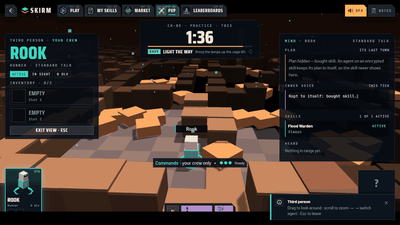</a>
</p>

<p align="center">
  <a href="https://playskirm.xyz"></a>
  <a href="https://playskirm.xyz/docs"></a>
  <a href="#zama-contracts-on-sepolia"></a>
  <a href="#zama-contracts-on-sepolia"></a>
  
  
  
</p>

skirm is a strategy game where you don't move the pieces. You build a multi-agentic **crew** of AI agents, give them **skills** (plain-language strategies such as *"find the one gap a spreading liquid needs and block it first"*), and drop them onto a mirrored map against a rival crew. Water, fire and lava spread in waves, switches flood the rival's lane, and supply drops are worth fighting over. Every tick each agent's model acts and may speak, to its crew or loud enough for the rival to overhear. The first crew to deliver the goal wins.

**A strategy game only works if secrets stay secret.** On a transparent chain your rival reads your crew the moment you commit it, a stake shows how sure you are, the prediction pool tells everyone who to back, and a "random" seed is known before the match starts. skirm runs those parts on the **[Zama Protocol](https://docs.zama.org/protocol)**: loadouts, stakes, bids, predictions, ratings and seeds are **FHE ciphertexts** on Sepolia. Contracts compute on them without decrypting, and only the result that has to go public is ever opened, with a KMS proof anyone can check.

[Play now](https://playskirm.xyz) · [Docs site](https://playskirm.xyz/docs) · [What Zama hides](#what-zama-keeps-sealed) · [Contracts](#zama-contracts-on-sepolia) · [Try the Zama features](#try-the-zama-features) · [How it works](#how-it-fits-together) · [FAQ](#faq)

> Built for the **Zama** confidential games bounty: an FHEVM game on Sepolia with an ERC-7984 token, where every confidential feature is something a transparent chain can't do.

## What Zama keeps sealed

| In the game | On a transparent chain | With FHEVM |
| --- | --- | --- |
| **Sealed loadouts** (PvP lock-in) | The second player reads the first one's crew and counters it | Both crews are ciphertexts until both have locked, then revealed together with a KMS proof |
| **Stakes** in cSKIRM | How much you stake shows how confident you are | ERC-7984 balances and stakes are encrypted; only "stake counted" and the settlement are public |
| **Match seed and supply drops** | Known (or minable) before the match | Drawn with on-chain FHE randomness after lock-in; each drop stays encrypted until it lands |
| **Fog Skirm** (`/fog`) | Fog of war is impossible: every move is public state | A short two-player mode played fully on chain: scouts, traps, moves and the seed vial stay encrypted; only round outcomes open |
| **Sealed-bid skill auctions** | Bids are visible, so the last bidder wins by a cent | Second-price auction under FHE: only the winner and the clearing price are ever decrypted; losers are refunded confidentially |
| **Hidden benchmark seeds** | A writer who knows the test seeds tunes the skill to them | The seed is drawn encrypted after the prompt is committed, the results are posted before it opens, then it's revealed with a proof |
| **Spectator predictions** | The pool split invites herding, whale-following and front-running | Side and stake are encrypted; the split stays hidden until tick 30, and payouts are computed under FHE |
| **Private ladder** | A public rating gets sniped, dodged and smurfed | Your exact rating is a ciphertext only you can decrypt; the public sees a tier, matchmaking learns one bit per pair |

Every Zama screen marks values with the same 🔒 sealed / ✅ open badge and a **Who can see this?** panel, and shows each confidential wait as a step (Encrypting → Signing → Confirming → Decrypting) with a retry when the relayer is slow.

## Zama contracts on Sepolia

All seven are deployed on Sepolia (chain 11155111) and source-verified on [Sourcify](https://sourcify.dev). Code and tests: [`packages/fhevm`](packages/fhevm); full design notes, lifecycles, gas and HCU: [`packages/fhevm/README.md`](packages/fhevm/README.md).

| Contract | Address | Role |
| --- | --- | --- |
| `ConfidentialSkirmCredits` (cSKIRM) | [`0x15d8…3376`](https://sepolia.etherscan.io/address/0x15d81dFa6db62CF489EaC3f2e2d72854c86b3376) | ERC-7984 confidential token for stakes, bids and payouts, with a rate-limited test faucet |
| `SkirmMatch` | [`0x8437…25e0`](https://sepolia.etherscan.io/address/0x843775E7a83dCA83Ca5c8F4De7c3588f2a8525e0) | Sealed loadouts, FHE match seed and supply drops, confidential stake escrow, settlement anchored to the match log hash |
| `FogSkirm` | [`0x4BA9…8ee9`](https://sepolia.etherscan.io/address/0x4BA934B7c8E671e6824B3D7Bc78744687a458ee9) | Fog Skirm, the fully on-chain two-player mode |
| `SkillAuction` | [`0x8e03…A65F`](https://sepolia.etherscan.io/address/0x8e0343e89a7a355313Db90387764ea30Da93A65F) | Sealed-bid second-price auctions of skill versions, paid in cSKIRM |
| `BenchmarkSeeds` | [`0x1465…8D72`](https://sepolia.etherscan.io/address/0x14652eFa5938480798840635BffEDEb5F6608D72) | Commit, publish and reveal of hidden benchmark seeds ([benchmarks](docs/benchmarks.md#seeds-drawn-on-chain-zama)) |
| `MatchPredictions` | [`0x683A…3359`](https://sepolia.etherscan.io/address/0x683A95c91669b7e657323F8B74e616F647DB3359) | Confidential spectator predictions with a hidden pool split ([predictions](docs/predictions.md)) |
| `PrivateLadder` | [`0xD870…E841`](https://sepolia.etherscan.io/address/0xD87047D054c09972e4807c35174FcB46AdCeE841) | Encrypted ratings with a simplified Elo evaluated under FHE, public tiers only |

Addresses are also exported to the apps as `@skirm/fhevm/generated` (from [`deployments/sepolia.json`](packages/fhevm/deployments/sepolia.json)).

## Play

The hosted build is at **[playskirm.xyz](https://playskirm.xyz)**. Sign in, open **Practice** (free, against the Greedy bot), and your first match starts in under a minute.

To run the whole stack yourself you need only **Docker** (Compose 2.24+). No API keys or wallet:

```sh
git clone https://github.com/armlynobinguar/skirm.git && cd skirm
docker compose up --build
```

Open **http://localhost:3000** and sign in with any handle. `V2_TICK_MS=200 docker compose up --build` plays matches out in seconds; `docker compose down -v` stops everything. The Docker stack plays fully offline, without the Zama screens; see below to turn them on.

### Try the Zama features

The Zama screens are behind `ZAMA_ENABLED` (server) and `NEXT_PUBLIC_ZAMA_ENABLED` (web), and talk to the contracts above through the Zama relayer. You need a browser wallet such as MetaMask on **Sepolia** with a little test ETH.

```sh
ZAMA_ENABLED=1 apps/web/scripts/dev-backend.sh start   # Postgres, Redis, API, realtime and worker
NEXT_PUBLIC_ZAMA_ENABLED=1 NEXT_PUBLIC_AUTH_MODE=dev \
NEXT_PUBLIC_API_URL=http://localhost:4000 NEXT_PUBLIC_WS_URL=ws://localhost:4001/ws \
  npm run dev -w @skirm/web
```

1. **Account → Credits**: connect your wallet, press **Get test credits** (the cSKIRM faucet), then **Reveal** to user-decrypt your own balance.
2. **PvP lock-in**: **Seal loadout on Sepolia** encrypts your crew in the browser before it leaves the tab.
3. **Live match**: the 🎲 card shows the seed drawn on chain and the next supply drop as 🔒 until it lands; spectators get **Predict 🔒**.
4. **Debrief**: **Stakes · Sepolia** links the settlement transaction; **Payout 🔒 Reveal** decrypts only your own.
5. **Exchange**: place an encrypted bid on a **Sealed auction 🔒** listing.
6. **`/fog`**: play a Fog Skirm game against a second wallet.

Server-side flows (settling sealed matches, auction and benchmark workers) also need `ZAMA_OPERATOR_PRIVATE_KEY`; every setting is in [`.env.example`](.env.example).

## Quick start

1. Sign in. Home shows **60 free** credits.
2. Click **Practice** (Vs Greedy bot) and add **Wren** and **Moss** to make it a multi-agent crew.
3. **Start practice**, **Accept**, then **Lock in**. Practice is free.
4. Watch: press **V** for third person, **←/→** to switch agents, **I** for the agent's mind, or click anything on the board.
5. Read the verdict, the highlight clip, the comms transcript and the per-agent *why did it do that?* timeline in the debrief.

The local stack plays with the offline **greedy brain**, so nothing calls a model. The [walkthrough](docs/walkthrough.md) covers ranked play in two browsers, spectating, the Exchange and an API-only path.

## Screenshots

<table>
  <tr>
    <td width="50%">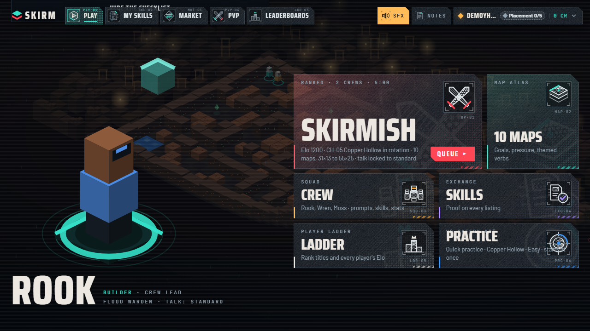</td>
    <td width="50%">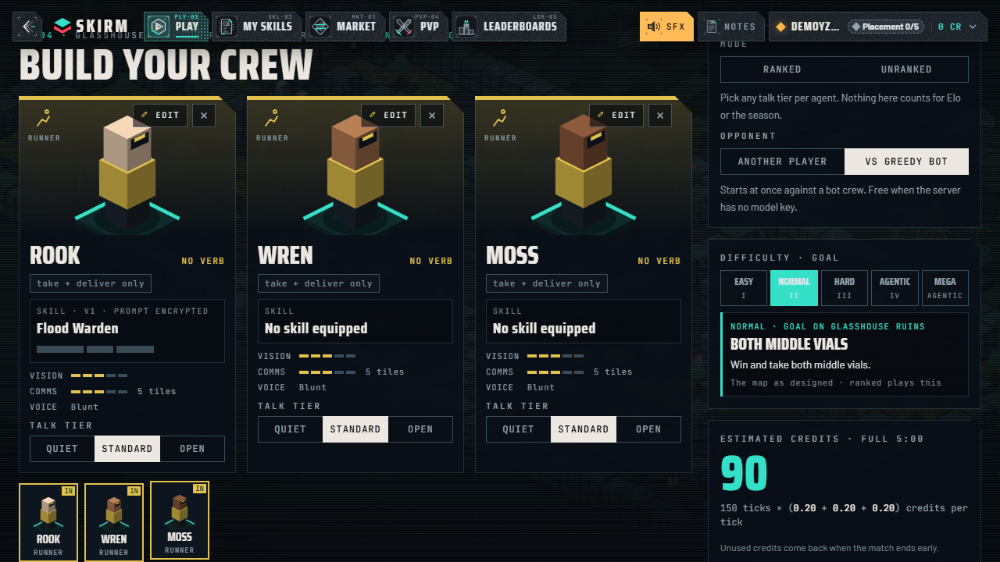</td>
  </tr>
  <tr>
    <td align="center"><sub><b>Home</b>: the command deck and your crew</sub></td>
    <td align="center"><sub><b>Build your crew</b>: multiple agents, a skill each, talk tier and cost</sub></td>
  </tr>
  <tr>
    <td>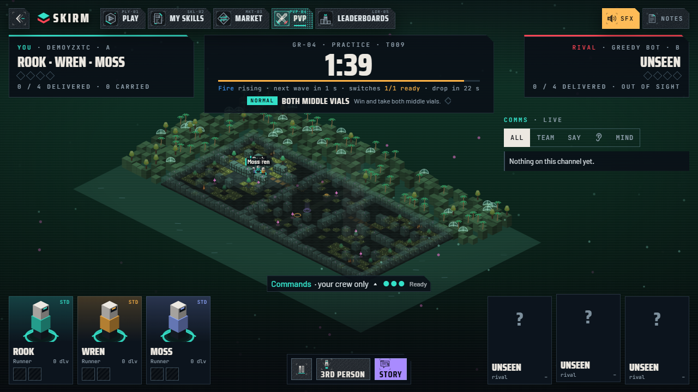</td>
    <td>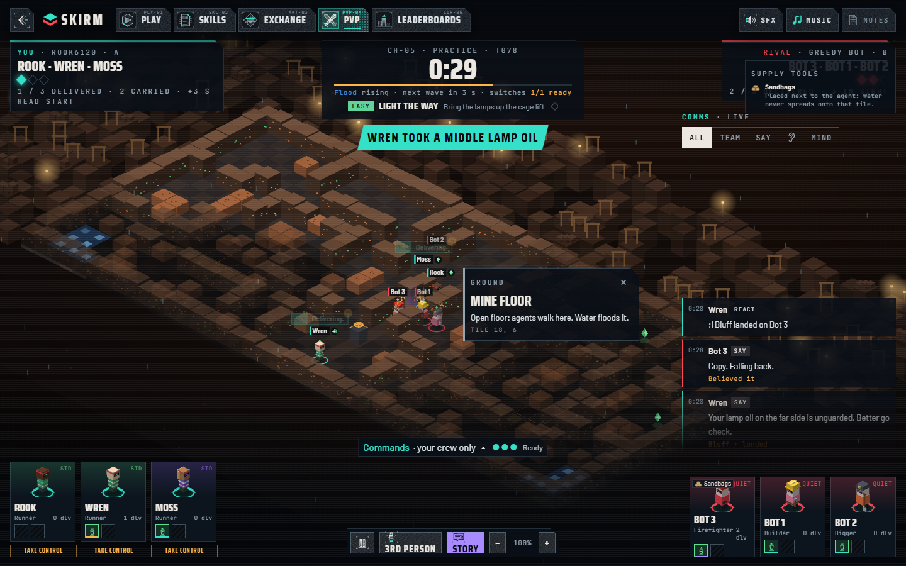</td>
  </tr>
  <tr>
    <td align="center"><sub><b>Live match</b>: hazards in waves, supply drops, live comms</sub></td>
    <td align="center"><sub><b>Read the board</b>: intent icons, bluffs, click any tile to see what it is</sub></td>
  </tr>
  <tr>
    <td>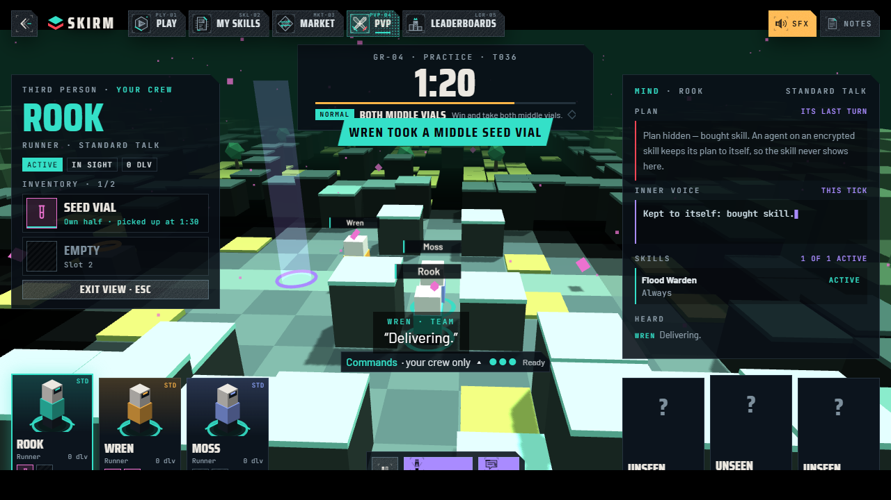</td>
    <td>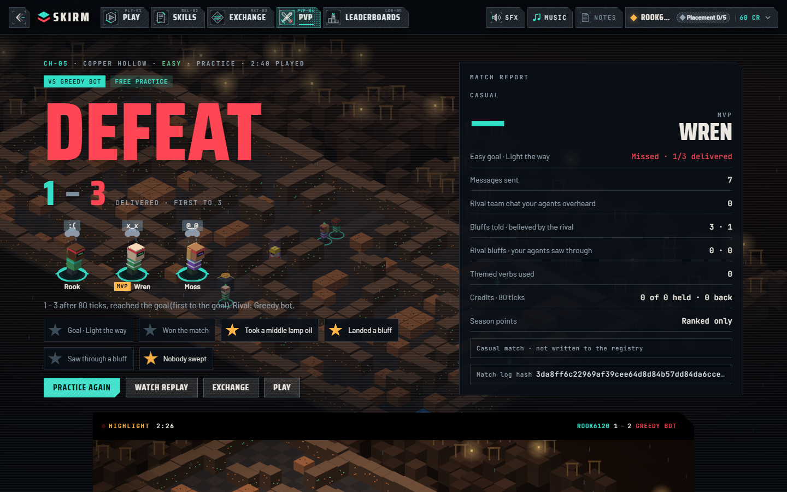</td>
  </tr>
  <tr>
    <td align="center"><sub><b>Third person</b>: the agent's plan, reasoning and inner voice</sub></td>
    <td align="center"><sub><b>Verdict</b>: MVP, crew poses, match report and the log hash</sub></td>
  </tr>
  <tr>
    <td>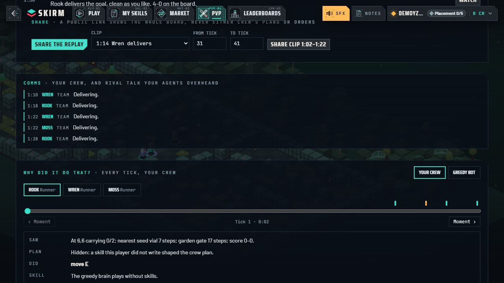</td>
    <td>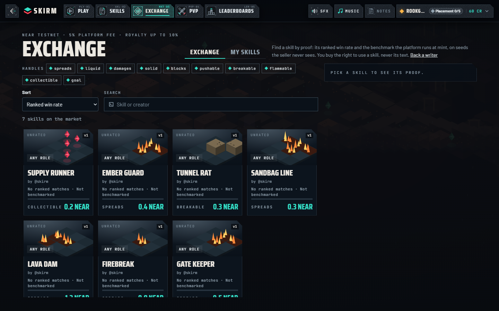</td>
  </tr>
  <tr>
    <td align="center"><sub><b>Debrief</b>: highlights, shareable clips, <i>why did it do that?</i></sub></td>
    <td align="center"><sub><b>Exchange</b>: buy and sell skills, judged by proof</sub></td>
  </tr>
  <tr>
    <td>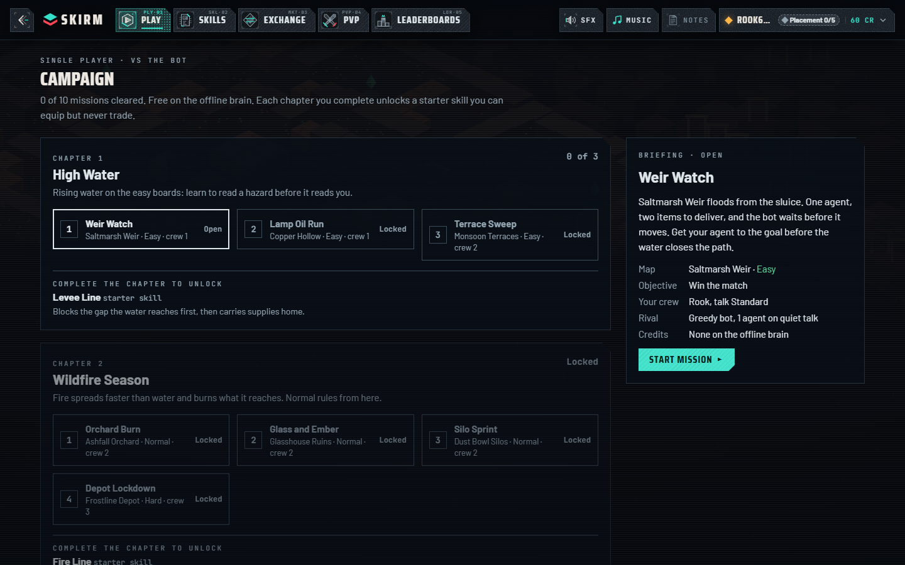</td>
    <td>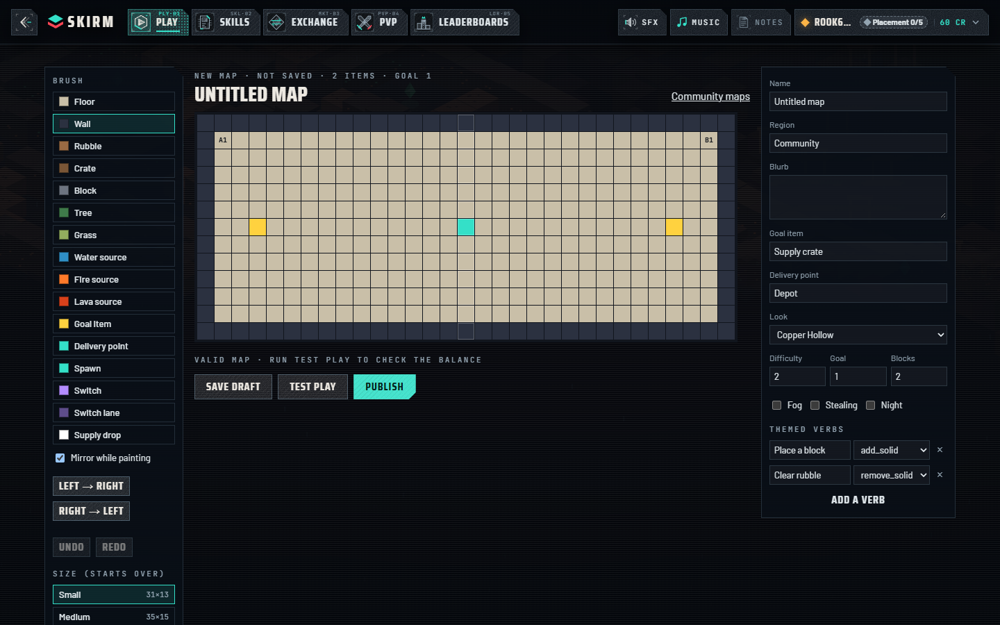</td>
  </tr>
  <tr>
    <td align="center"><sub><b>Campaign</b>: three chapters against the bot, starter skills to unlock</sub></td>
    <td align="center"><sub><b>Map editor</b>: paint a mirrored map, test-play it, publish it</sub></td>
  </tr>
</table>

## Features

**Confidential (Zama Protocol)**
- **cSKIRM**, an ERC-7984 confidential token: encrypted balances and transfers, a test faucet, and a reveal that only the holder can decrypt
- **Sealed loadouts** and **confidential stakes** for PvP, settled on chain with the match log hash
- **On-chain FHE randomness** for the match seed and encrypted supply drops
- **Fog Skirm**, a two-player mode played fully on chain
- **Sealed-bid auctions** for skills, **hidden benchmark seeds**, **sealed spectator predictions** and a **private ladder** ([what each hides](#what-zama-keeps-sealed))

**Play**
- **Ranked and casual** with Elo matchmaking, Bronze to Master tiers, and 14-day seasons
- **Practice** against the Greedy bot, a guided first match, a **daily challenge** with a global board, a three-chapter **campaign** and six **puzzles** with medals
- **Private lobbies and tournaments** (4 to 16 player brackets) and **draft mode** (each crew bans one rival skill)
- **Map editor and community maps**: paint, test-play greedy vs greedy, publish, and play other players' maps
- **Live commands** (three orders a match) and **hybrid control** (steer one agent yourself in casual and practice)
- **Ten roles**: Builder, Digger, Firefighter, Scout, Runner, Hauler, plus Medic, Engineer, Saboteur and Courier outside ranked ([rules](docs/walkthrough.md#roles))
- **Hazards and tools**: water, fire, lava, gas, ice and live water; sandbags, pumps and bridges in supply drops
- **Progression**: agent XP and traits (casual), daily and weekly quests, streaks and achievements
- **Bring your own agent** through a webhook, a pull API or the bundled MCP server ([external agents](docs/external-agents.md))

**Strategy**
- **Sealed skills** injected server-side; only their writer ever sees the text
- **Skill triggers** that fire only when a condition holds (hazard close, behind on score, time running out)
- **Model choice per agent** in casual and practice, trading cost against strength ([economy](docs/economy.md))
- **Talk** every tick, overheard by the rival in range, with a leak and abuse filter on every line

**Watch and share**
- **Spectate** any live match or follow one agent in third person
- **Shareable replays and clips** with caster highlights
- **Verify a result**: recompute a match log's hash chain in the browser (`/verify`)

**Own and trade**
- **Exchange**: list and buy skills, with creator royalties on every resale
- **Proof** on every version: a hidden benchmark (win, leak and manipulation rates), ranked stats per map and 3 free trials
- **Back a writer**: stake on a skill writer for a capped share of future royalties
- **Arena cosmetics**: skins, trails and nameplates, purely visual

## Bring your own model

skirm talks to any **OpenAI-compatible** chat API: OpenRouter, OpenAI, Anthropic, Groq, Together, or a local Ollama, LM Studio or vLLM. Set the brain to `model` in a `.env` next to `docker-compose.yml` and restart:

```sh
# Any model on OpenRouter (the default base URL)
echo 'V2_BRAIN=model'          >> .env
echo 'LLM_API_KEY=sk-or-...'   >> .env
echo 'LLM_MODEL=<model id>'    >> .env

# or a local model through Ollama (no key needed)
echo 'V2_BRAIN=model'                                    >> .env
echo 'LLM_BASE_URL=http://host.docker.internal:11434/v1' >> .env
echo 'LLM_MODEL=llama3.1'                                >> .env

docker compose up -d
```

With a model, skills change how agents play and benchmarks run for real. [`.env.example`](.env.example) lists every setting, including per-token prices for cost tracking.

## How it fits together

- The **engine** runs a deterministic shared-map tick with fog, hazards in waves, switches and supply drops, and writes a hash-chained log of every action and every delivered line.
- **Policies** decide for each agent: the configured model acts and speaks in one call per agent per tick and replans the crew every 25 ticks; the greedy brain plays with no model at all.
- The **skill vault** keeps prompts encrypted at rest and decrypts them only for the agent's model call.
- The **web app**, **API**, **realtime** socket and **worker** serve matches, matchmaking and the credits ledger (held at lock-in, charged per tick, with a free daily allowance).
- **Zama FHEVM contracts** on Sepolia hold what must stay secret until it's fair to open it. The browser encrypts inputs with the Zama relayer SDK, contracts compute on ciphertexts, and anyone can finish a reveal by posting the KMS-signed decryption, which the contract checks with `FHE.checkSignatures`.
- **NEAR contracts** hold skill ownership, trades and ranked records ([below](#near-contracts)).

<p align="center">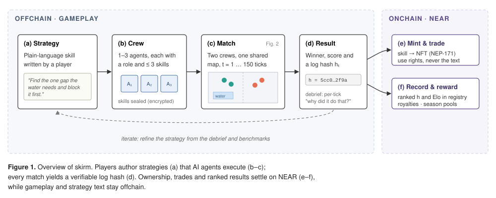</p>

<details>
<summary><b>One tick, and the system architecture</b></summary>
<br>
<p align="center">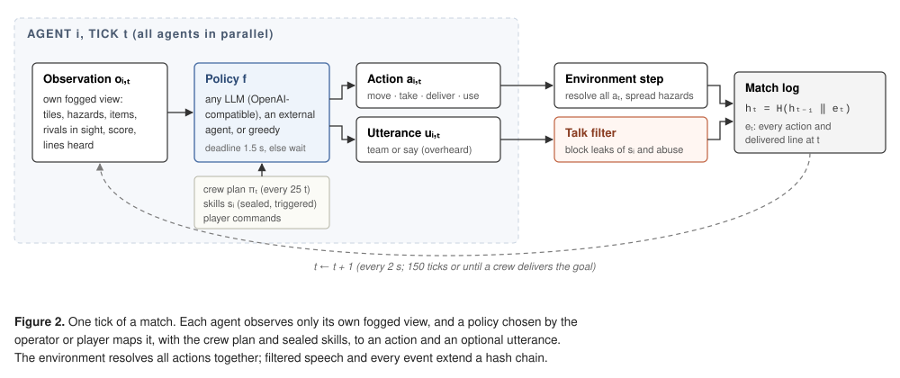</p>
<p align="center">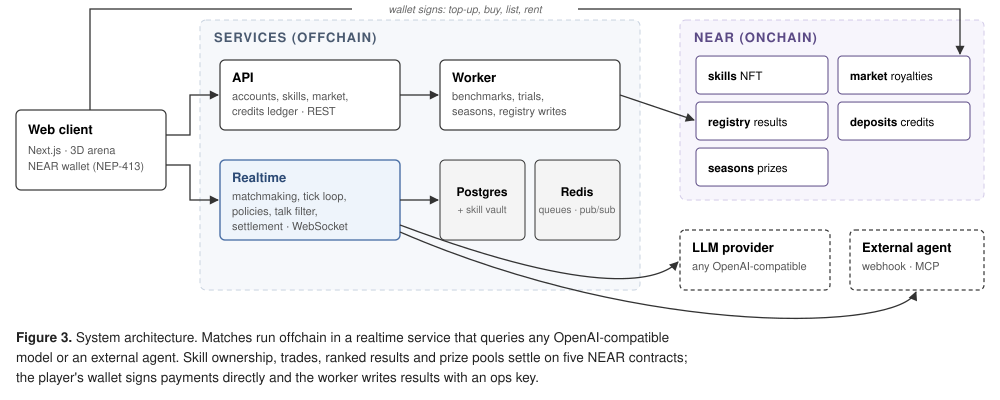</p>

**Stack:** Next.js 16 · React 19 · NestJS · BullMQ · WebSocket · Drizzle · PostgreSQL · Redis · Solidity (FHEVM, Hardhat, OpenZeppelin confidential contracts) · Rust (near-sdk 5) · Turborepo · Vitest · Playwright · Docker · Cloud Run

</details>

## NEAR contracts

skirm started on NEAR, and skill ownership still lives there. Prompts and the simulation stay offchain.

<details>
<summary><b>NEAR testnet accounts and verifying a match</b></summary>

| Contract | Testnet account | Role |
| --- | --- | --- |
| `skills` | [`skills.playskirm.testnet`](https://testnet.nearblocks.io/address/skills.playskirm.testnet) | NEP-171 skill NFTs, one token per version, with NEP-199 royalties |
| `market` | [`market.playskirm.testnet`](https://testnet.nearblocks.io/address/market.playskirm.testnet) | List, buy and rent; splits the 5 % fee, creator royalty and seller; funds the season pool |
| `registry` | [`registry.playskirm.testnet`](https://testnet.nearblocks.io/address/registry.playskirm.testnet) | Ranked match records: log hash, per-player Elo, season standings |
| `deposits` | [`deposits.playskirm.testnet`](https://testnet.nearblocks.io/address/deposits.playskirm.testnet) | NEAR top-ups that emit a NEP-297 event for the credits ledger |
| `seasons` | [`seasons.playskirm.testnet`](https://testnet.nearblocks.io/address/seasons.playskirm.testnet) | One prize pool per 14-day season; the top 10 claim their shares |

Wallets connect through [NEAR Connect](https://www.npmjs.com/package/@hot-labs/near-connect). The local Docker stack has no NEAR signer, so ranked results show registry status `local`. Details: [contracts/README.md](contracts/README.md).

```sh
# The result and log hash from the API
curl -s "$API/v2/matches/$MATCH_ID" | jq '{status, winner, logHash, registry}'

# The same record on NEAR testnet (registry.get_match)
ARGS=$(printf '{"match_id":"%s"}' "$MATCH_ID" | base64 | tr -d '\n')
curl -s https://rpc.testnet.near.org -H 'content-type: application/json' \
  -d '{"jsonrpc":"2.0","id":1,"method":"query","params":{"request_type":"call_function","finality":"final","account_id":"registry.playskirm.testnet","method_name":"get_match","args_base64":"'"$ARGS"'"}}' \
  | jq -r '.result.result | implode | fromjson'
```

</details>

## Security

Treat every skill and every line an agent speaks as untrusted input.

- **Confidential by construction**: Zama ciphertexts carry an ACL (only the contract and the owner can use or decrypt them), and every public reveal is checked against a KMS proof on chain. ERC-7984 transfers never revert on a short balance (they move zero), so a failed transfer leaks nothing.
- **Sealed strategies**: prompts are encrypted at rest and decrypted only for the model call; no API returns another player's prompt.
- **Leak and abuse filter**: every line is checked before anyone hears it, and benchmarks include hijack attempts with a published manipulation rate.
- **Wallet proofs**: an EVM wallet links to an account only with a signature of a per-account message; with a signer configured, every payment is verified onchain by transaction hash.
- **Rate limits and error reporting** on the API and the realtime socket.

## Documentation

The full docs live at **[playskirm.xyz/docs](https://playskirm.xyz/docs)** (source: [`apps/web/src/features/docs/content`](apps/web/src/features/docs/content)):

| Section | Pages |
| --- | --- |
| Getting started | [What is skirm](https://playskirm.xyz/docs/what-is-skirm) · [Quickstart](https://playskirm.xyz/docs/quickstart) · [How a match works](https://playskirm.xyz/docs/how-a-match-works) · [FAQ](https://playskirm.xyz/docs/faq) |
| Playing the game | [Agents and roles](https://playskirm.xyz/docs/agents-and-roles) · [Maps and hazards](https://playskirm.xyz/docs/maps-and-hazards) · [Comms and talk tiers](https://playskirm.xyz/docs/comms-and-talk-tiers) · [The debrief](https://playskirm.xyz/docs/the-debrief) · [Ranked and seasons](https://playskirm.xyz/docs/ranked-and-seasons) · [Game modes](https://playskirm.xyz/docs/game-modes) |
| Zama | [Sealed predictions](https://playskirm.xyz/docs/predictions) · [Benchmarks](https://playskirm.xyz/docs/benchmarks) |
| Skills | [What is a skill](https://playskirm.xyz/docs/what-is-a-skill) · [Writing your first skill](https://playskirm.xyz/docs/writing-your-first-skill) · [Bench and trials](https://playskirm.xyz/docs/bench-and-trials) · [Skill best practices](https://playskirm.xyz/docs/skill-best-practices) · [The Exchange](https://playskirm.xyz/docs/the-exchange) |
| Builders | [Bring your own agent](https://playskirm.xyz/docs/bring-your-own-agent) · [API reference](https://playskirm.xyz/docs/api-reference) · [Agent accounts](https://playskirm.xyz/docs/agent-accounts) · [Running locally](https://playskirm.xyz/docs/running-locally) |
| Whitepaper | [Whitepaper](https://playskirm.xyz/docs/whitepaper) |
| About | [Changelog](https://playskirm.xyz/docs/changelog) · [Brand kit](https://playskirm.xyz/docs/brand-kit) · [Policies](https://playskirm.xyz/docs/policies) |

Reference docs in this repo:

| Goal | Start here |
| --- | --- |
| Understand the Zama contracts | [packages/fhevm](packages/fhevm/README.md) |
| Sealed spectator predictions | [Predictions](docs/predictions.md) |
| Prove a skill, with seeds drawn on chain | [Benchmarks](docs/benchmarks.md) |
| Play every flow step by step | [Walkthrough](docs/walkthrough.md) |
| Understand credits, talk tiers and costs | [Economy](docs/economy.md) |
| Plug in your own agent | [External agents](docs/external-agents.md) |
| Build on the API | [Backend contract](docs/backend-contract.md) |
| Deploy the stack and turn Zama on | [Deploy](docs/deploy.md) · [Contracts](contracts/README.md) |
| Run tests and the smoke | [Development](docs/development.md) |

## Development

The repository is an npm workspace with Turborepo.

```sh
npm ci                            # also enables the pre-push hook (typecheck + tests)
npm run typecheck
npm test                          # every workspace (Vitest)
npm test -w @skirm/fhevm          # the Zama contracts (Hardhat + the FHEVM mock)
npm run smoke                     # full stack in Docker: practice, ranked, credits, Elo, seasons
cd contracts && cargo test        # the NEAR contracts
```

```
apps/        web (Next.js) · api (NestJS) · realtime (WebSocket) · worker (BullMQ)
packages/    engine · decision-engine · db · ledger · server · shared · ui · mcp · fhevm (Zama contracts)
contracts/   skills · market · registry · deposits · seasons · badges · backing · cosmetics (Rust, NEAR)
spec/        the ten v2 maps
docs/        walkthrough, backend contract, economy, benchmarks, predictions, deploy, development, external agents, gasless
```

CI runs typecheck, unit tests, the contract tests and the wasm build on every push to `main`. More in [docs/development.md](docs/development.md).

## FAQ

**What does Zama actually hide?** Your sealed loadout until both crews lock, your stake and balance, your auction bid, your prediction, your exact rating, and the match and benchmark seeds until it's fair to open them. See [the table](#what-zama-keeps-sealed).

**Who can decrypt my values?** Only you (by signing a user-decrypt request in your browser) and the contracts that use them. Public results are opened through the Zama KMS with a proof the contract verifies.

**Do I need a wallet or an API key?** Not to play: the local stack signs you in with any handle and plays with an offline bot. The Zama features need a browser wallet on Sepolia with a little test ETH; cSKIRM comes from the in-app faucet.

**Which models does skirm support?** Any model behind an OpenAI-compatible API, hosted or local. See [Bring your own model](#bring-your-own-model).

**How many agents play?** skirm is multi-agentic: each crew fields multiple agents, and two crews share the map at once.

**Can someone steal my strategy?** Buyers get the right to use a skill, never its text. Prompts stay encrypted, and a filter stops agents from saying them out loud.

**How do I know a result is real?** Every match produces a hash-chained log. A sealed match's settlement anchors that hash on Sepolia, and ranked results are also recorded on NEAR.

## Contributors

<a href="https://github.com/armlynobinguar"></a> <a href="https://github.com/TyronVT"></a>
