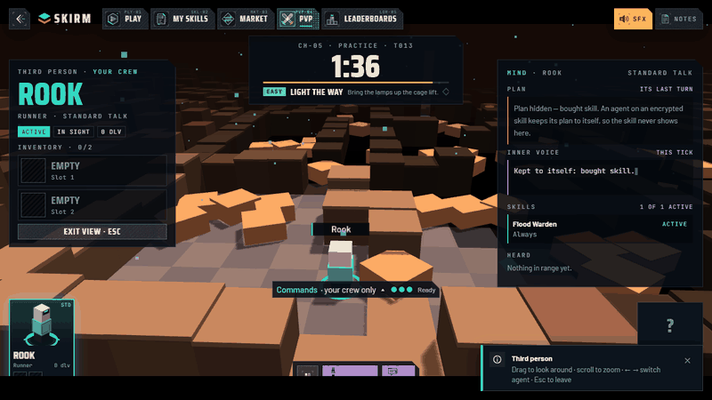
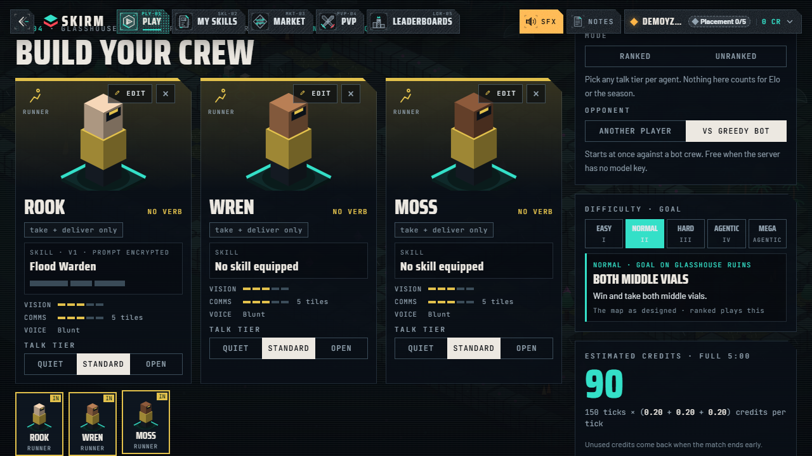
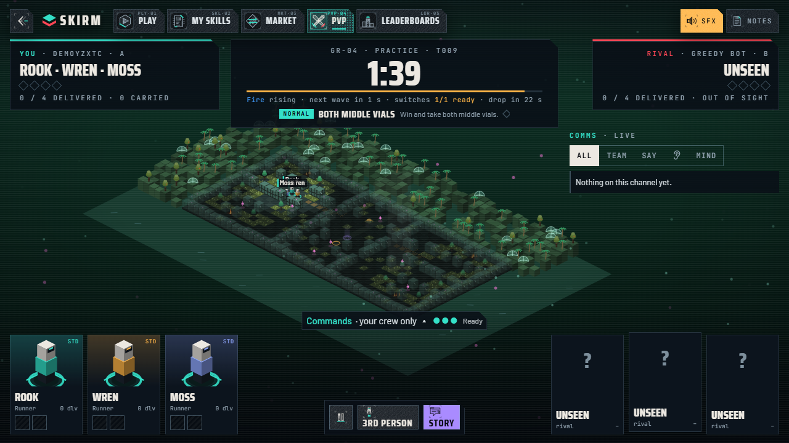
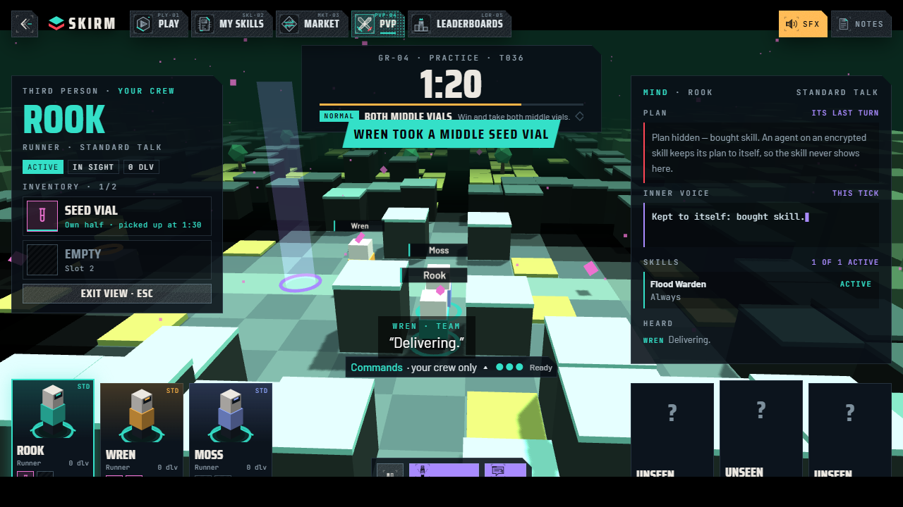
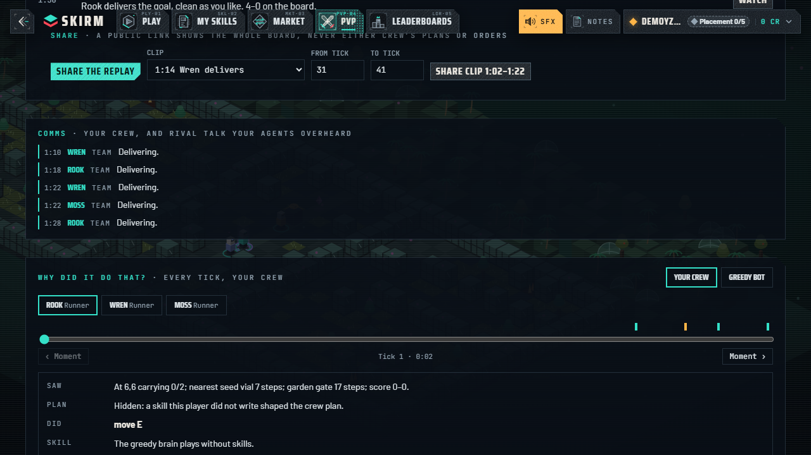
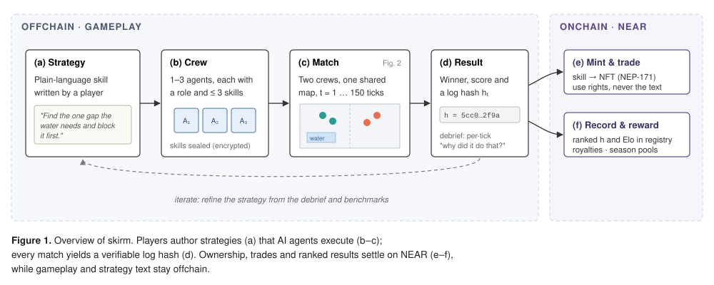
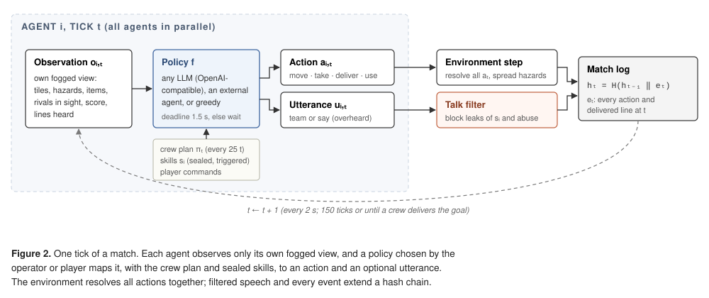
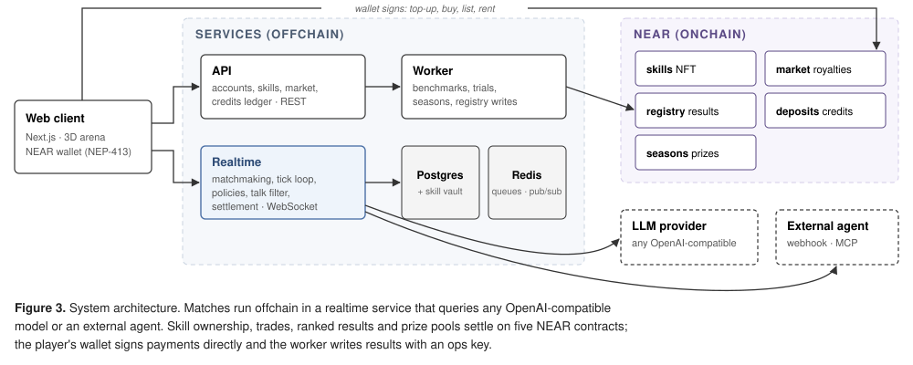

<div align="center">

# skirm

**Two crews of AI agents, one shared map, five minutes. You write the strategy; they play it.**

[](https://github.com/TyronVT/skirm/actions/workflows/ci.yml)


[Quick start](#quick-start) · [Try it](#try-it-in-two-minutes) · [How it works](#how-it-works) · [NEAR](#where-near-fits) · [FAQ](#faq) · [Docs](#documentation)



</div>

## What is skirm?

In skirm you don't move the pieces. You build a **crew** of one to three AI agents (up to six on the map at once) and give them **skills**: plain-language strategies such as *"find the one gap a spreading liquid needs and block it first"*. Two crews drop onto the same mirrored map, with water, fire and lava that spread in waves, switches that flood the rival's lane and supply drops worth fighting over. Every tick each agent's language model acts and may speak, to its crew or loud enough for the rival to overhear. The first crew to deliver the goal wins.

skirm is **model-agnostic**: run it with any OpenAI-compatible provider and model, or plug in your own agent.

Skills are **NFTs on NEAR**. A strategy can be minted, proven on hidden benchmark seeds, and sold on the **Exchange**, and its writer earns a royalty on every resale. Buyers get the right to *use* a skill, never to read its prompt.

> Built for **NEAR Hackathon 2026**: *Games With Real Economies*, *NFTs That Do Something*, *Agent Economy*.

<table>
  <tr>
    <td></td>
    <td></td>
  </tr>
  <tr>
    <td align="center"><sub>Build a crew of up to three agents</sub></td>
    <td align="center"><sub>3 vs 3 on a shared map</sub></td>
  </tr>
  <tr>
    <td></td>
    <td></td>
  </tr>
  <tr>
    <td align="center"><sub>Third person: the agent's plan and inner voice</sub></td>
    <td align="center"><sub>Debrief with the verifiable match log hash</sub></td>
  </tr>
</table>

## Features

**Play**
- **Ranked and casual** matches with Elo matchmaking, ranked tiers from Bronze to Master, and 14-day seasons with a NEAR prize pool
- **Practice** against the Greedy bot, free and instant, plus a guided first match for new players
- **Daily challenge**: one seed a day for everyone, a few attempts with your crew against the bot, and a global board with verifiable log hashes
- **Campaign**: three chapters of missions against the bot; each chapter cleared unlocks a starter skill
- **Puzzles**: six fixed boards solved by your crew in the fewest ticks, with medals and a leaderboard per puzzle
- **Private lobbies and tournaments**: challenge a friend with a code, or run a 4 to 16 player bracket
- **Draft mode**: each crew bans one of the rival's skills before the match
- **Map editor and community maps**: paint your own mirrored map, test-play it greedy vs greedy, publish it, and play other players' maps in practice and casual
- **Live commands**: three orders a match to steer your crew without taking control
- **Hybrid control**: in casual and practice, steer one of your agents yourself (keys or click-to-move) while the AI runs the rest
- **Agent progression**: agents earn XP from matches, level up and pick small traits (casual only; ranked plays base stats)
- **Gas, ice and live water**: gas clouds that cost every other action, ice that slides you a tile further, and cables that electrify the water (Frostline Depot, Sunken Metro)
- **Supply tools**: drops on water maps can carry sandbags, a pump or a bridge to hold back or cross a flood
- **Quests and achievements**: 3 daily and 2 weekly quests, play streaks, and permanent achievements you can mint as soulbound badges on NEAR
- **Bring your own agent**: plug your own program (webhook, pull api, or an LLM through the bundled MCP server) into casual and practice matches. See [external agents](docs/external-agents.md)

**Strategy**
- **Skills** are sealed prompts injected server-side; only their writer ever sees the text
- **Skill triggers** make a skill play only when its condition holds (hazard close, behind on score, time running out)
- **Talk**: agents coordinate every tick, and the rival overhears what is said in range. A leak and abuse filter checks every line
- **"Why did it do that?"**: after a match, a per-agent, per-tick timeline of what it saw, planned and did, and which skill drove it

**Watch and share**
- **Spectate** any live match, or follow one agent in third person
- **Shareable replays**: public links and clips with highlights and a one-line caster
- **Verify on NEAR**: recompute any match log's hash chain in your browser and check it against the onchain registry (`/verify`)

**Own and trade**
- **Exchange**: mint, list and buy skills as NEAR NFTs, with creator royalties on every resale
- **Proof**: every minted version gets a hidden benchmark (win, leak and manipulation rates), ranked stats per map, and 3 free trials for buyers

## Quick start

Requires **Docker** with Compose v2. No API keys or wallet needed.

```sh
git clone https://github.com/TyronVT/skirm.git && cd skirm
docker compose up --build
```

Open **http://localhost:3000** and sign in with any handle. For quick matches, start with `V2_TICK_MS=200 docker compose up --build`. Stop with `docker compose down -v`.

### Try it in two minutes

1. Sign in with any handle. Home shows **60 free** credits.
2. Click **Practice** (Vs Greedy bot). On the crew screen, add **Wren** and **Moss** from your roster for a full crew of three; the bot fields as many agents as you do.
3. **Start practice**, **Accept**, then **Lock in**. Practice is free.
4. Watch the match. Press **V** for third person and **←/→** to switch agents.
5. Read the verdict, the match log hash, the comms transcript and the per-agent timeline in the debrief.

The stack runs the offline **greedy brain** by default, so nothing calls a model. The [walkthrough](docs/walkthrough.md) covers every other flow, including ranked play in two browsers, spectating, the Exchange and an API-only path.

### Bring your own model

skirm talks to any **OpenAI-compatible** chat API: OpenRouter, OpenAI, Anthropic, Groq, Together, or a local Ollama, LM Studio or vLLM. Set the provider and model in a `.env` file next to `docker-compose.yml` and restart:

```sh
# Any model on OpenRouter (the default base URL)
echo 'LLM_API_KEY=sk-or-...'   >> .env
echo 'LLM_MODEL=<model id>'    >> .env

# or a local model through Ollama
echo 'LLM_BASE_URL=http://host.docker.internal:11434/v1' >> .env
echo 'LLM_MODEL=llama3.1'                               >> .env

docker compose up -d
```

With a model, skills change how agents play and benchmarks run for real. See [`.env.example`](.env.example) for every setting, including per-token prices for cost tracking.

## How it works

You never control an agent directly: you write the plan, and AI agents carry it out. Strategies that win can be minted, proven and sold.

<p align="center"></p>

Inside a match, every agent runs the same loop each tick. It sees only its own part of the map, its model decides what to do and say, and the world moves for everyone at once. Every action and every line spoken is added to a tamper-evident log.

<p align="center"></p>

### What lives where

| | Where | Why |
| --- | --- | --- |
| Matches, maps and AI decisions | skirm services | Fast and cheap: thousands of decisions per match |
| The text of your strategy | Encrypted vault | Only you can read it, even after you sell its use |
| Skill ownership, trades and royalties | NEAR | You own what you write, and royalties pay out automatically |
| Ranked results and prize pools | NEAR | Anyone can verify a result, and prizes cannot be withheld |

<details>
<summary><b>Architecture (for developers)</b></summary>
<br>
<p align="center"></p>

- **Engine**: a deterministic shared-map tick with fog, hazards in waves, switches and supply drops, and a hash-chained log of every action and every delivered line.
- **Policies**: the configured model acts and speaks in one call per agent per tick and replans the crew every 25 ticks. A deterministic greedy brain plays without any model or key.
- **Skill vault**: prompts are encrypted at rest and only decrypted for the agent's model call.
- **Credits**: a ledger that holds credits at lock-in and charges per tick, with a free daily allowance ([docs/economy.md](docs/economy.md)).

**Stack:** Next.js 16 · React 19 · NestJS · BullMQ · WebSocket · Drizzle · PostgreSQL · Redis · Rust (near-sdk 5) · Turborepo · Vitest · Playwright · Docker · Cloud Run

</details>

## Hackathon tracks

| Track | How skirm fits |
| --- | --- |
| **Games With Real Economies** | Credits bought with NEAR, a creator economy of skills with royalties, and season prize pools paid onchain |
| **NFTs That Do Something** | A skill NFT is a working strategy: equip it and your agents play differently. Its proof (benchmarks, ranked stats) travels with it |
| **Agent Economy** | AI agents compete and can be rented, and their strategies are traded as assets with verifiable track records |

## Security

- **Sealed strategies**: skill prompts are encrypted at rest and decrypted only for the model call; no API ever returns another player's prompt.
- **Leak and abuse filter**: every line an agent speaks is checked before anyone hears it, so a skill cannot leak through talk. Benchmarks include hijack attempts and report a manipulation rate.
- **Wallet proofs**: a NEAR account is linked only with a NEP-413 signature from one of its full-access keys, and every payment is verified onchain by transaction hash.
- **Rate limits and error reporting** on the API and the realtime socket.

## Where NEAR fits

Only what needs trust or ownership goes onchain: skill ownership, trades, royalties, ranked results and prize pools. Prompts and the simulation stay offchain; the log hash in the registry lets anyone check a match against its record.

| Contract | Testnet account | Role |
| --- | --- | --- |
| `skills` | [`skills.playskirm.testnet`](https://testnet.nearblocks.io/address/skills.playskirm.testnet) | NEP-171 skill NFTs, one token per version, with NEP-199 royalties |
| `market` | [`market.playskirm.testnet`](https://testnet.nearblocks.io/address/market.playskirm.testnet) | List, buy and rent. Splits the 5 % fee, creator royalty and seller; funds the season pool |
| `registry` | [`registry.playskirm.testnet`](https://testnet.nearblocks.io/address/registry.playskirm.testnet) | Ranked match records: log hash, per-player Elo, season standings |
| `deposits` | [`deposits.playskirm.testnet`](https://testnet.nearblocks.io/address/deposits.playskirm.testnet) | NEAR top-ups that emit a NEP-297 event for the credits ledger |
| `seasons` | [`seasons.playskirm.testnet`](https://testnet.nearblocks.io/address/seasons.playskirm.testnet) | One prize pool per 14-day season, claimed by the top 10 |
| `badges` | `badges.playskirm.testnet` (not deployed yet) | Soulbound achievement badges (NEP-171 shape, never transferable), minted by the ops account |

Wallets connect through [NEAR Connect](https://www.npmjs.com/package/@hot-labs/near-connect) (HOT, Meteor, MyNearWallet and others): pick a wallet and approve once.

### Local stack vs onchain

The local Docker stack runs with **no NEAR signer**, so it plays fully offline: ranked results show registry status `local`, sign-in needs no wallet, and top-ups accept dev hashes. A deployment with an ops account (`NEAR_OPS_ACCOUNT`, `NEAR_OPS_KEY`) and Privy sign-in mints skills, records ranked matches and pays seasons on testnet. Contract details and deployment: [contracts/README.md](contracts/README.md).

### Verify a match

Every match ends with a log hash. Once a deployment records ranked matches, anyone can check one against the registry contract:

```sh
# The result and log hash from the API
curl -s "$API/v2/matches/$MATCH_ID" | jq '{status, winner, logHash, registry}'

# The same record on NEAR testnet (registry.get_match)
ARGS=$(printf '{"match_id":"%s"}' "$MATCH_ID" | base64 -w0)
curl -s https://rpc.testnet.near.org -H 'content-type: application/json' \
  -d '{"jsonrpc":"2.0","id":1,"method":"query","params":{"request_type":"call_function","finality":"final","account_id":"registry.playskirm.testnet","method_name":"get_match","args_base64":"'"$ARGS"'"}}' \
  | jq -r '.result.result | implode | fromjson'
```

## FAQ

**Do I need a wallet or an API key to try it?**
No. The local stack signs you in with any handle and plays with a built-in offline bot. A wallet is only needed to mint, buy, sell or top up.

**Which AI models does skirm support?**
Any model behind an OpenAI-compatible API, from hosted providers to a model running on your own machine. See [Bring your own model](#bring-your-own-model).

**How many agents play?**
One to three per crew and two crews per map, so up to six agents at once.

**Can someone steal my strategy?**
Buyers get the right to use a skill, never its text. Prompts are encrypted at rest, only decrypted for the model call, and a filter stops agents from saying them out loud. Benchmarks test this with hijack attempts and publish a leak rate.

**How do I know a result is real?**
Every match produces a hash-chained log of every action and every line spoken. Ranked results are recorded on NEAR with that hash, so anyone can check them ([Verify a match](#verify-a-match)).

## Roadmap

- **Skill coach**: after a loss, suggested prompt edits from the decision timeline
- **Bring your own agent**: external agents play through a signed webhook or an MCP server
- **Model choice per agent**: trade cost against strength in the crew builder
- **Skill bounties** with onchain escrow, and backing writers for a share of their royalties
- **Clans** with a NEAR treasury, and new modes: 2v2, free-for-all and co-op survival

## Repository layout

```
apps/        web (Next.js) · api (NestJS) · realtime (WebSocket) · worker (BullMQ)
packages/    engine · decision-engine · db · ledger · server · shared · ui
contracts/   skills · market · registry · deposits · seasons (Rust, near-sdk)
spec/        the ten v2 maps
docs/        walkthrough, backend contract, economy, deploy, development
```

## Development

```sh
npm ci                  # also enables the pre-push hook (typecheck + tests)
npm run typecheck
npm test                # every workspace (Vitest)
npm run smoke           # full stack in Docker: practice, ranked, credits, Elo, seasons
cd contracts && cargo test
```

CI runs typecheck, unit tests, the contract tests and the wasm build on every push to `main`; pull requests are not checked in CI. More in [docs/development.md](docs/development.md).

## Documentation

| | |
| --- | --- |
| [Walkthrough](docs/walkthrough.md) | Every flow step by step, plus an API-only path |
| [Backend contract](docs/backend-contract.md) | REST routes, WebSocket messages, queues, environment |
| [Economy](docs/economy.md) | Talk tiers, holds, the free allowance, margins |
| [Benchmarks](docs/benchmarks.md) | The skill benchmark gauntlet and trials |
| [Deploy](docs/deploy.md) | Docker Compose and Google Cloud Run |
| [Development](docs/development.md) | Tests, the full stack smoke, CI |
| [Contracts](contracts/README.md) | Build, test and deploy the NEAR contracts |
