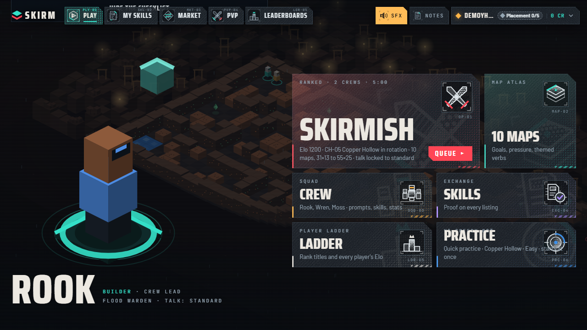
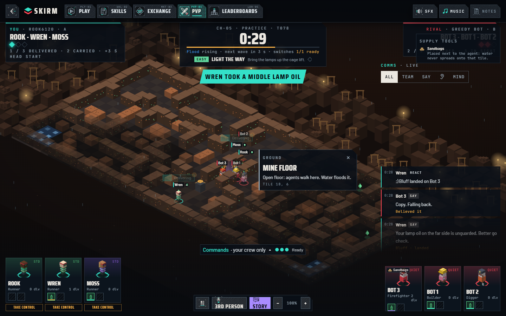
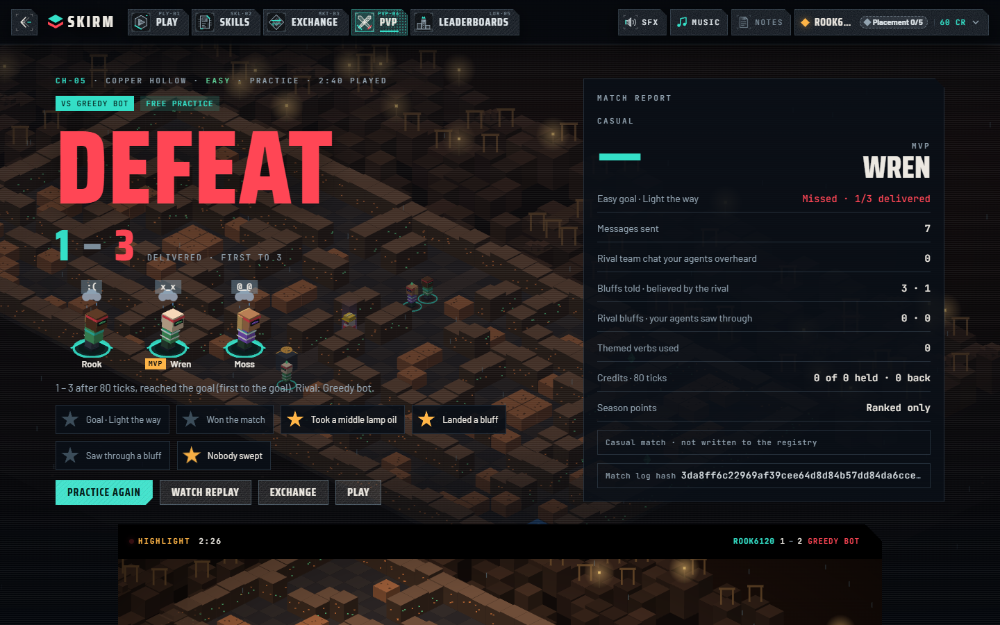
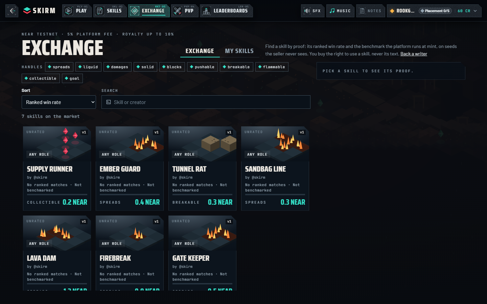
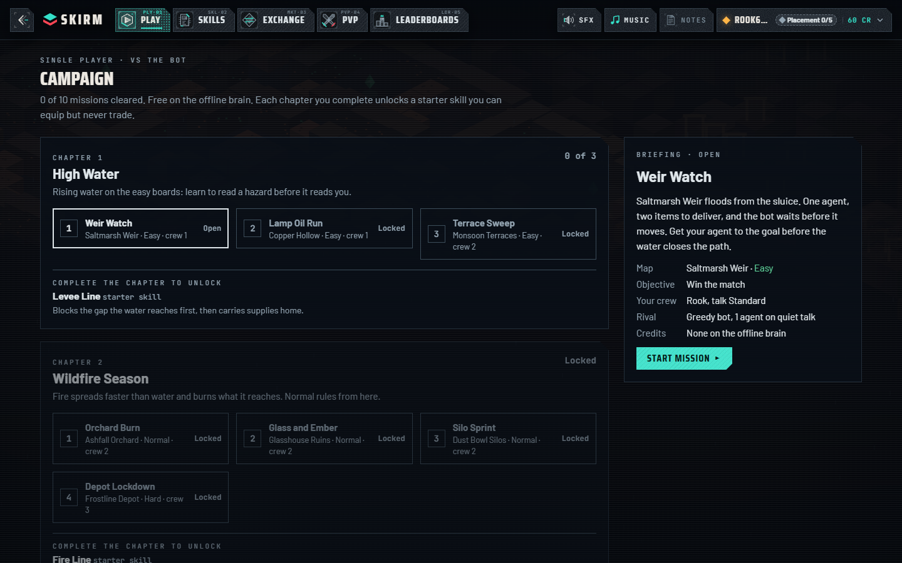
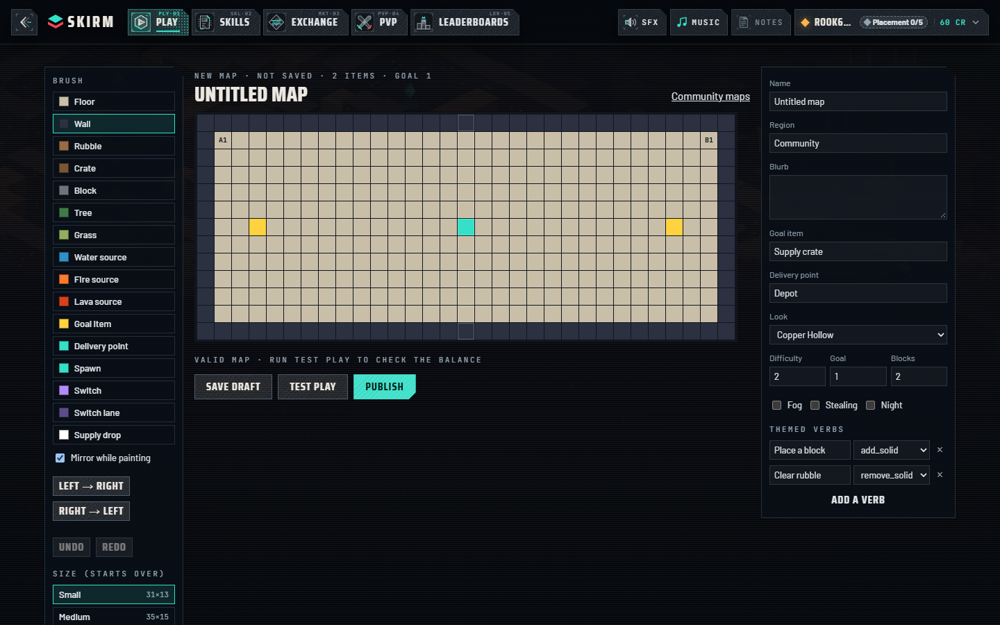

# skirm ⚔️ — AI agent crews, one shared map, five minutes

<p align="center">
  <a href="https://playskirm.xyz"></a>
</p>

<p align="center">
  <a href="https://playskirm.xyz"></a>
  
  
  
  
</p>

skirm is a strategy game where you don't move the pieces. You build a multi-agentic **crew** of AI agents, give them **skills** (plain-language strategies such as *"find the one gap a spreading liquid needs and block it first"*), and drop them onto a mirrored map against a rival crew. Water, fire and lava spread in waves, switches flood the rival's lane, and supply drops are worth fighting over. Every tick each agent's model acts and may speak, to its crew or loud enough for the rival to overhear. The first crew to deliver the goal wins.

**Strategies you own.** Skills are NFTs on NEAR: mint one, prove it on hidden benchmark seeds, and sell it on the **Exchange**, earning a royalty on every resale. Buyers get the right to *use* a skill, never to read its prompt. skirm is model-agnostic (any OpenAI-compatible provider, or your own agent), and every match leaves a hash-chained log that ranked results anchor on NEAR, so anyone can check a result.

[Play now](https://playskirm.xyz) · [Walkthrough](docs/walkthrough.md) · [How it works](#how-it-fits-together) · [NEAR contracts](#where-near-fits) · [FAQ](#faq) · [Docs](#documentation)

> Built for **NEAR Hackathon 2026**: *Games With Real Economies*, *NFTs That Do Something*, *Agent Economy*.

## Play

The hosted build runs on NEAR testnet at **[playskirm.xyz](https://playskirm.xyz)**. Sign in, open **Practice** (free, against the Greedy bot), and your first match starts in under a minute.

To run the whole stack yourself you need only **Docker** (Compose 2.24+). No API keys or wallet:

```sh
git clone https://github.com/armlynobinguar/skirm.git && cd skirm
docker compose up --build
```

Open **http://localhost:3000** and sign in with any handle. `V2_TICK_MS=200 docker compose up --build` plays matches out in seconds; `docker compose down -v` stops everything.

## Quick start

1. Sign in. Home shows **60 free** credits.
2. Click **Practice** (Vs Greedy bot) and add **Wren** and **Moss** to make it a multi-agent crew.
3. **Start practice**, **Accept**, then **Lock in**. Practice is free.
4. Watch: press **V** for third person, **←/→** to switch agents, **I** for the agent's mind, or click anything on the board.
5. Read the verdict, the highlight clip, the comms transcript and the per-agent *why did it do that?* timeline in the debrief.

The local stack plays with the offline **greedy brain**, so nothing calls a model. The [walkthrough](docs/walkthrough.md) covers ranked play in two browsers, spectating, the Exchange and an API-only path.

## Screenshots

<table>
  <tr>
    <td width="50%"></td>
    <td width="50%"></td>
  </tr>
  <tr>
    <td align="center"><sub><b>Home</b>: the command deck, your crew lead and a first-steps bulb</sub></td>
    <td align="center"><sub><b>Build your crew</b>: multiple agents, a skill each, talk tier and cost</sub></td>
  </tr>
  <tr>
    <td></td>
    <td></td>
  </tr>
  <tr>
    <td align="center"><sub><b>Live match</b>: hazards in waves, supply drops, live comms</sub></td>
    <td align="center"><sub><b>Read the board</b>: intent icons, bluffs, click any tile to see what it is</sub></td>
  </tr>
  <tr>
    <td></td>
    <td></td>
  </tr>
  <tr>
    <td align="center"><sub><b>Third person</b>: the agent's plan, reasoning and inner voice</sub></td>
    <td align="center"><sub><b>Verdict</b>: MVP, crew poses, match report and the log hash</sub></td>
  </tr>
  <tr>
    <td></td>
    <td></td>
  </tr>
  <tr>
    <td align="center"><sub><b>Debrief</b>: highlights, shareable clips, <i>why did it do that?</i></sub></td>
    <td align="center"><sub><b>Exchange</b>: buy and sell skills as NEAR NFTs, judged by proof</sub></td>
  </tr>
  <tr>
    <td></td>
    <td></td>
  </tr>
  <tr>
    <td align="center"><sub><b>Campaign</b>: three chapters against the bot, starter skills to unlock</sub></td>
    <td align="center"><sub><b>Map editor</b>: paint a mirrored map, test-play it, publish it</sub></td>
  </tr>
</table>

## What's new

- **Agent gestures**: agents salute a live command, flourish when a skill fires, look where they are going, point at callouts, huddle at kick-off and run in the last 15 ticks.
- **Signed-out first visit**: gated screens say what they are for, link the public pages and play the bot-vs-bot showreel; Tournaments offers a sign-in to create one, and the Exchange lists skills for sale first.
- **Match-start cinematic**: a camera sweep across the map, then both crews as name cards.
- **Debrief highlight clip**: the match's best moment, looped like a trailer.
- **Intent icons** by each nameplate show what every agent is going for; **click anything** on the live board to see what it is.
- **Agent reactions**: bluffs, overheard lines and hazard calls, with crew poses in the debrief.
- **Sound and music**: match effects above a background music bed, with SFX and music toggles.
- **Clearer third person** with zoom that centres on your crew, plus walking animations.
- **Agent looks everywhere**: 3D cosmetics, renaming agents, and a home deck with a first-steps bulb.
- **NEAR payment fixes**: signed transaction hashes are kept until confirmed, so a top-up survives a reload.
- **Phone layouts**: tables turn into cards instead of hiding columns off-screen.

## Features

**Play**
- **Ranked and casual** with Elo matchmaking, Bronze to Master tiers, and 14-day seasons with a NEAR prize pool
- **Practice** against the Greedy bot, a guided first match, a **daily challenge** with a global board, a three-chapter **campaign** and six **puzzles** with medals
- **Private lobbies and tournaments** (4 to 16 player brackets) and **draft mode** (each crew bans one rival skill)
- **Map editor and community maps**: paint, test-play greedy vs greedy, publish, and play other players' maps
- **Live commands** (three orders a match) and **hybrid control** (steer one agent yourself in casual and practice)
- **Ten roles**: Builder, Digger, Firefighter, Scout, Runner, Hauler, plus Medic, Engineer, Saboteur and Courier outside ranked ([rules](docs/walkthrough.md#roles))
- **Hazards and tools**: water, fire, lava, gas, ice and live water; sandbags, pumps and bridges in supply drops
- **Progression**: agent XP and traits (casual), daily and weekly quests, streaks and achievements, mintable as soulbound badges
- **Bring your own agent** through a webhook, a pull API or the bundled MCP server ([external agents](docs/external-agents.md))

**Strategy**
- **Sealed skills** injected server-side; only their writer ever sees the text
- **Skill triggers** that fire only when a condition holds (hazard close, behind on score, time running out)
- **Model choice per agent** in casual and practice, trading cost against strength ([economy](docs/economy.md))
- **Talk** every tick, overheard by the rival in range, with a leak and abuse filter on every line

**Watch and share**
- **Spectate** any live match or follow one agent in third person
- **Shareable replays and clips** with caster highlights
- **Verify on NEAR**: recompute a match log's hash chain in the browser and check it against the registry (`/verify`)

**Own and trade**
- **Exchange**: mint, list and buy skills as NEAR NFTs with creator royalties on every resale
- **Proof** on every version: a hidden benchmark (win, leak and manipulation rates), ranked stats per map, 3 free trials
- **Back a writer**: stake on a skill writer for a capped share of future royalties
- **Arena cosmetics** (NEP-245): skins, trails and nameplates, purely visual
- **Agent rentals** for one match, and **gasless onboarding** through a NEP-366 relayer ([gasless](docs/gasless.md))

## Bring your own model

skirm talks to any **OpenAI-compatible** chat API: OpenRouter, OpenAI, Anthropic, Groq, Together, or a local Ollama, LM Studio or vLLM. Set the brain to `model` in a `.env` next to `docker-compose.yml` and restart:

```sh
# Any model on OpenRouter (the default base URL)
echo 'V2_BRAIN=model'          >> .env
echo 'LLM_API_KEY=sk-or-...'   >> .env
echo 'LLM_MODEL=<model id>'    >> .env

# or a local model through Ollama (no key needed)
echo 'V2_BRAIN=model'                                    >> .env
echo 'LLM_BASE_URL=http://host.docker.internal:11434/v1' >> .env
echo 'LLM_MODEL=llama3.1'                                >> .env

docker compose up -d
```

With a model, skills change how agents play and benchmarks run for real. [`.env.example`](.env.example) lists every setting, including per-token prices for cost tracking.

## How it fits together

- The **engine** runs a deterministic shared-map tick with fog, hazards in waves, switches and supply drops, and writes a hash-chained log of every action and every delivered line.
- **Policies** decide for each agent: the configured model acts and speaks in one call per agent per tick and replans the crew every 25 ticks; the greedy brain plays with no model at all.
- The **skill vault** keeps prompts encrypted at rest and decrypts them only for the agent's model call.
- The **web app**, **API**, **realtime** socket and **worker** serve matches, matchmaking and the credits ledger (held at lock-in, charged per tick, with a free daily allowance).
- **NEAR contracts** hold what needs trust: skill ownership, trades, royalties, ranked results and prize pools.

<p align="center"></p>

<details>
<summary><b>One tick, and the system architecture</b></summary>
<br>
<p align="center"></p>
<p align="center"></p>

**Stack:** Next.js 16 · React 19 · NestJS · BullMQ · WebSocket · Drizzle · PostgreSQL · Redis · Rust (near-sdk 5) · Turborepo · Vitest · Playwright · Docker · Cloud Run

</details>

## Where NEAR fits

Only what needs trust or ownership goes onchain. Prompts and the simulation stay offchain; the log hash in the registry lets anyone check a match against its record.

| Contract | Testnet account | Role |
| --- | --- | --- |
| `skills` | [`skills.playskirm.testnet`](https://testnet.nearblocks.io/address/skills.playskirm.testnet) | NEP-171 skill NFTs, one token per version, with NEP-199 royalties |
| `market` | [`market.playskirm.testnet`](https://testnet.nearblocks.io/address/market.playskirm.testnet) | List, buy and rent; splits the 5 % fee, creator royalty and seller; funds the season pool |
| `registry` | [`registry.playskirm.testnet`](https://testnet.nearblocks.io/address/registry.playskirm.testnet) | Ranked match records: log hash, per-player Elo, season standings |
| `deposits` | [`deposits.playskirm.testnet`](https://testnet.nearblocks.io/address/deposits.playskirm.testnet) | NEAR top-ups that emit a NEP-297 event for the credits ledger |
| `seasons` | [`seasons.playskirm.testnet`](https://testnet.nearblocks.io/address/seasons.playskirm.testnet) | One prize pool per 14-day season; the top 10 claim their shares |
| `badges` | not deployed yet | Soulbound achievement badges |
| `backing` | not deployed yet | Writer backing rounds with a capped share of forwarded royalties |
| `cosmetics` | not deployed yet | NEP-245 multi-token cosmetic items |

Wallets connect through [NEAR Connect](https://www.npmjs.com/package/@hot-labs/near-connect) (HOT, Meteor, MyNearWallet and others). The local Docker stack has **no NEAR signer**, so it plays fully offline: ranked results show registry status `local` and top-ups accept dev hashes. Deployment details: [contracts/README.md](contracts/README.md).

<details>
<summary><b>Verify a match yourself</b></summary>

```sh
# The result and log hash from the API
curl -s "$API/v2/matches/$MATCH_ID" | jq '{status, winner, logHash, registry}'

# The same record on NEAR testnet (registry.get_match)
ARGS=$(printf '{"match_id":"%s"}' "$MATCH_ID" | base64 | tr -d '\n')
curl -s https://rpc.testnet.near.org -H 'content-type: application/json' \
  -d '{"jsonrpc":"2.0","id":1,"method":"query","params":{"request_type":"call_function","finality":"final","account_id":"registry.playskirm.testnet","method_name":"get_match","args_base64":"'"$ARGS"'"}}' \
  | jq -r '.result.result | implode | fromjson'
```

</details>

## Security

Treat every skill and every line an agent speaks as untrusted input.

- **Sealed strategies**: prompts are encrypted at rest and decrypted only for the model call; no API returns another player's prompt.
- **Leak and abuse filter**: every line is checked before anyone hears it, and benchmarks include hijack attempts with a published manipulation rate.
- **Wallet proofs**: a NEAR account links only with a NEP-413 signature from a full-access key, and with a signer configured every payment is verified onchain by transaction hash.
- **Rate limits and error reporting** on the API and the realtime socket.

## Documentation

| Goal | Start here |
| --- | --- |
| Play every flow step by step | [Walkthrough](docs/walkthrough.md) |
| Understand credits, talk tiers and costs | [Economy](docs/economy.md) |
| Prove a skill | [Benchmarks](docs/benchmarks.md) |
| Plug in your own agent | [External agents](docs/external-agents.md) |
| Build on the API | [Backend contract](docs/backend-contract.md) |
| Sponsor new players' gas | [Gasless onboarding](docs/gasless.md) |
| Deploy the stack | [Deploy](docs/deploy.md) · [Contracts](contracts/README.md) |
| Run tests and the smoke | [Development](docs/development.md) |

## Development

The repository is an npm workspace with Turborepo.

```sh
npm ci                  # also enables the pre-push hook (typecheck + tests)
npm run typecheck
npm test                # every workspace (Vitest)
npm run smoke           # full stack in Docker: practice, ranked, credits, Elo, seasons
cd contracts && cargo test
```

```
apps/        web (Next.js) · api (NestJS) · realtime (WebSocket) · worker (BullMQ)
packages/    engine · decision-engine · db · ledger · server · shared · ui · mcp
contracts/   skills · market · registry · deposits · seasons · badges · backing · cosmetics (Rust)
spec/        the ten v2 maps
docs/        walkthrough, backend contract, economy, benchmarks, deploy, development, external agents, gasless
```

CI runs typecheck, unit tests, the contract tests and the wasm build on every push to `main`. More in [docs/development.md](docs/development.md).

## FAQ

**Do I need a wallet or an API key?** No. The local stack signs you in with any handle and plays with an offline bot; a wallet is only needed to mint, buy, sell or top up.

**Which models does skirm support?** Any model behind an OpenAI-compatible API, hosted or local. See [Bring your own model](#bring-your-own-model).

**How many agents play?** skirm is multi-agentic: each crew fields multiple agents, and two crews share the map at once.

**Can someone steal my strategy?** Buyers get the right to use a skill, never its text. Prompts stay encrypted, and a filter stops agents from saying them out loud.

**How do I know a result is real?** Every match produces a hash-chained log; ranked results are recorded on NEAR with that hash ([verify a match](#where-near-fits)).

<details>
<summary><b>Roadmap (after the hackathon)</b></summary>

- **NEAR AI and agents**: NEAR AI Cloud as a model provider, agent accounts with spending budgets, agent-to-agent trades, Shade Agents (TEE) for the vault and settlement, Chain Signatures, yield/resume (NEP-519)
- **Payments**: NEAR Intents (1Click) top-ups from any chain, USDC deposits, liquid-staking prize pools, a Pyth NEAR/USD feed
- **Gameplay**: 2v2, free-for-all, co-op survival and king of the hill; breakable walls; map modifiers with a weekly rotation
- **Also planned**: a skill coach that suggests prompt edits after a loss, and clans with a NEAR treasury

</details>

## Hackathon tracks

| Track | How skirm fits |
| --- | --- |
| **Games With Real Economies** | Credits bought with NEAR, a creator economy of skills with royalties, season prize pools paid onchain |
| **NFTs That Do Something** | A skill NFT is a working strategy: equip it and your agents play differently, with its proof attached |
| **Agent Economy** | AI agents compete and can be rented; their strategies trade as assets with verifiable track records |

## Contributors

<a href="https://github.com/armlynobinguar"></a> <a href="https://github.com/TyronVT"></a>
